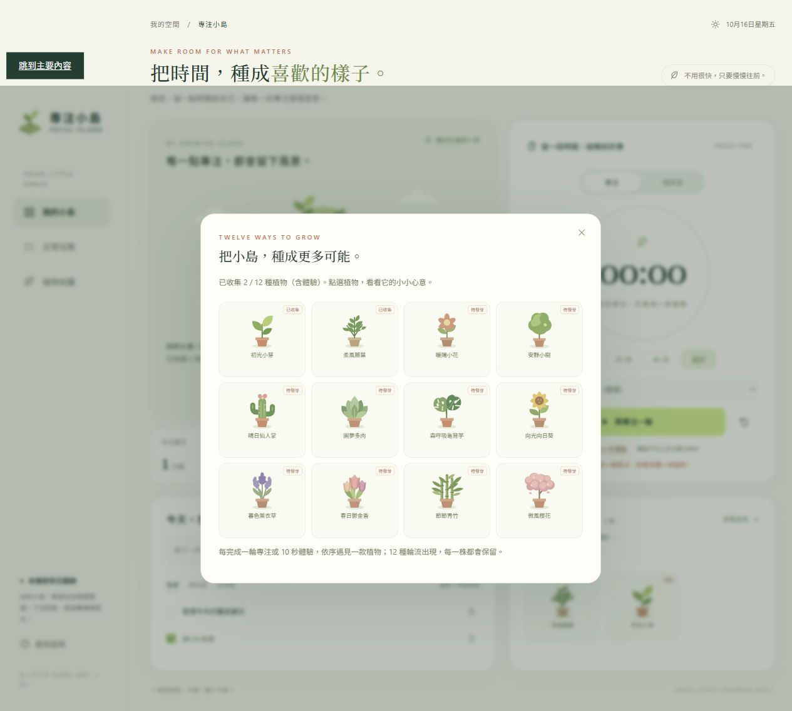

# 專注小島 Focus Island

把專注的時間，種成一座小島。

專注小島是一個輕量的個人專注工具，結合任務清單、倒數計時與植物收藏。從一件想完成的小事開始，每完成一輪專注，就為自己的小島留下一株植物。

**[線上體驗](https://xinyou1220.github.io/focus-island/)**


## 功能

- **任務清單**：新增、完成、篩選與刪除任務，支援撤銷刪除。
- **專注倒數**：15、25、45 分鐘快捷設定，或自訂 1～60 分鐘；可暫停、繼續與重設。
- **短暫休息**：提供 5 分鐘休息模式，讓下一段專注更有餘裕。
- **12 種植物**：完成倒數後依序獲得植物，收藏會隨每一輪努力慢慢增加。
- **植物圖鑑**：預覽所有植物造型與專屬文字，查看已收集的種類。
- **10 秒體驗**：快速走完計時到種植的流程，體驗成果獨立標示。
- **自動保存**：任務、植物與計時狀態保存在目前瀏覽器，重新開啟可接續使用。
- **響應式介面**：支援桌面與手機、鍵盤操作及減少動態效果偏好。

## 遇見 12 種小風景

初光小芽、柔風蕨葉、暖陽小花、安靜小樹、晴日仙人掌、圓夢多肉、森呼吸龜背芋、向光向日葵、暮色薰衣草、春日鬱金香、節節青竹、微風櫻花。

每獲得一株植物就前進一種，12 種循環出現。圖鑑預覽不會增加收藏數；體驗植物會保留「體驗」標記，不列入正式專注分鐘與輪數。



## 開始使用

1. 開啟 [線上網站](https://xinyou1220.github.io/focus-island/)，或直接用瀏覽器開啟 `index.html`。
2. 寫下一件想完成的小事，選擇這一輪的專注時間。
3. 按下開始，完成後到小島與收藏看看新植物。

不需要帳號、安裝步驟或後端服務。HTML、CSS、JavaScript 與 SVG 插畫都包含在單一 `index.html`，沒有外部字型或程式庫依賴。

## 專案內容

- `index.html`：完整應用程式與內嵌植物插畫。
- `SPEC.md`：功能規則與介面規格。
- `tests/timer-check.cjs`：計時、保存、收藏與資料相容性檢查。
- `screenshots/`：桌面、手機與植物圖鑑截圖。

使用 Node.js 可執行邏輯檢查：

```sh
node tests/timer-check.cjs
```

## 資料保存

進度使用 localStorage 儲存在目前裝置的此瀏覽器，沒有雲端同步。清除網站資料、切換瀏覽器或網址，可能看不到原本的進度。網頁關閉時不會發出通知；再次開啟後會依保存的截止時間恢復與結算。
