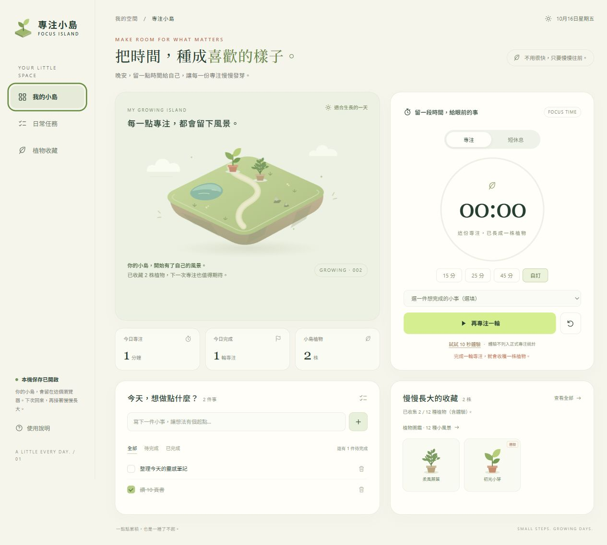

# 繳交草稿

請先替換標題中的個人資料，再貼到課程的「文字輸入」區。截圖需使用課程編輯器插入圖片，單貼本機路徑無法讓老師看到。

## 標題

［學校簡稱］ ［學號］ ［系級簡稱］ ［姓名］ 專注小島

## 網站連結

[開啟專注小島](https://xinyou1220.github.io/focus-island/)

## 網站介面截圖

建議將 `screenshots/desktop-verified.jpg` 插入課程編輯器；手機版截圖為 `screenshots/mobile-verified.jpg`。畫面中成果為實際操作測試資料，新訪客會從空小島開始。

## 規格文字說明

**作品名稱：專注小島 Focus Island**

**目的與對象：** 為需要安排讀書、作業與個人工作的大學生，提供任務清單及專注倒數，將完成的專注轉換為小島上的植物，讓努力的累積可以被看見。

**操作流程：** 新增小任務 → 設定專注時間 → 開始倒數 → 完成一輪 → 獲得植物 → 查看今日成果與植物收藏。

**主要功能：**

1. 任務清單：新增 1～80 字任務、勾選與取消完成、刪除及撤銷，並依全部、待完成、已完成篩選。
2. 專注計時：預設 25 分鐘，提供 15、25、45 分鐘與 1～60 分鐘自訂；可開始、暫停、繼續及重設，重設進行中的一輪前會先確認。
3. 種植互動：每完成一輪正式專注獲得一株植物，共有 12 種造型，依獲得順序循環出現；植物圖鑑可預覽全部種類與已收集狀態。小島與收藏同步更新，勾選任務、暫停或中途重設不會直接獲得植物。
4. 快速體驗：提供 10 秒體驗，方便驗證完整互動；獲得的體驗植物會標示，且不計入正式專注分鐘與輪數。
5. 休息與統計：提供 5 分鐘短休息，並顯示今日正式專注分鐘、完成輪數及累積植物。休息不發植物獎勵。
6. 自動保存：透過 localStorage 儲存任務、植物與計時狀態，重新整理後可恢復。倒數依預計結束時間計算，減少背景分頁造成的誤差，同一輪只會結算一次。
7. 響應式介面：支援桌面與手機，提供鍵盤操作、明顯焦點及減少動態效果支援。

**技術與限制：** 全部 HTML、CSS、JavaScript 及插畫整理於單一 index.html，無需後端或外部程式庫。資料只保存在同一網址、同一裝置的此瀏覽器，不跨裝置同步；清除網站資料會失去進度。網頁關閉時不發背景通知，重新開啟後才恢復與結算。

**AI 協作與修正：** 先與 AI 討論並選定「專注小島」，整理功能與驗收規格，再製作單檔網頁。檢查後補上 hidden 優先樣式，避免隱藏內容仍出現；修正超界日期資料可能讓植物介紹出錯的問題；為手機導覽補上可存取名稱，並改善手機標籤換行。之後依使用回饋將植物由 4 種增加至 12 種，新增可預覽造型與收集狀態的植物圖鑑，並驗證原有進度仍可保留。實際操作驗證任務管理、暫停與重整恢復、10 秒體驗，以及一分鐘正式專注；另以模擬時間執行 18 項計時、保存與植物收藏測試，全數通過。

**公開驗證：** 已透過 GitHub Pages 發布，確認公開網址正常回傳網頁，並直接在公開網站完成新增任務及 10 秒體驗種植。
